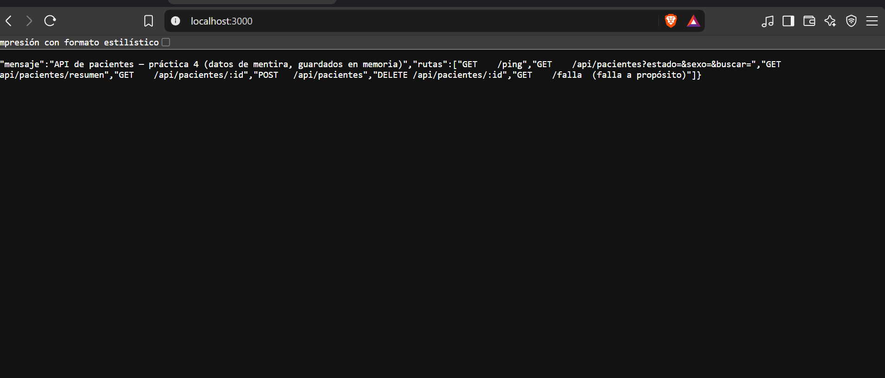
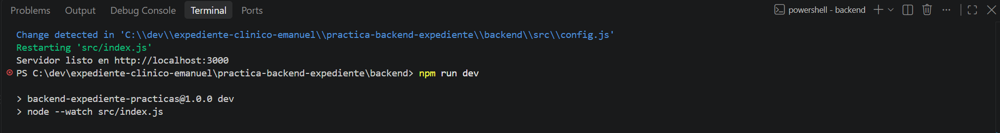
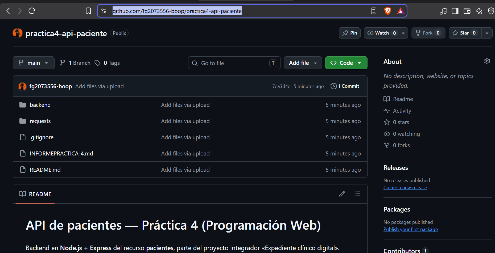

# Informe técnico — Práctica 4: programación del lado del servidor

| | |
|---|---|
| **Alumno** | Fernando González Méndez |
| **Materia** | Programación Web · Instituto Tecnológico Superior de Tepeaca (ITST) |
| **Práctica** | 4 — Ejercicios de programación del lado del servidor |
| **Fecha** | 17 de noviembre de 2026 |
| **Repositorio** | [https://github.com/fg2073556-boop/practica4-api-paciente](https://github.com/fg2073556-boop/practica4-api-paciente) |

## 1. Objetivo y recurso elegido

El objetivo de esta práctica fue construir con Node.js y Express una API REST: un servidor que recibe peticiones HTTP y responde en formato JSON. La organicé por capas (rutas, controladores y datos) y le puse rutas para consultar (una lista con filtros, un resumen y un paciente por su id), dar de alta con validación, dar de baja, manejar los errores con el código de estado correcto y un archivo de pruebas `.http`. Los datos son ficticios y viven en memoria (un arreglo), no en una base de datos.

Elegí el recurso **pacientes** porque el paciente es la base de mi proyecto del expediente clínico de la Clínica Emanuel: sin pacientes no hay expediente. Así, lo que practiqué aquí (rutas, validación y errores) lo puedo reutilizar después en el proyecto real. Usé 6 pacientes inventados para no manejar datos de personas reales.

## 2. Entorno y cómo ejecutarlo

- **Sistema y herramientas:** Windows 11, Visual Studio Code y la extensión REST Client (para probar el archivo `.http`).
- **Tecnologías:** Node.js 18.11 o superior (hace falta para `node --watch`, que reinicia el servidor solo cuando guardo un archivo), npm, Express 5 y dotenv 18.
- **Puerto:** se lee de la variable `PORT` del archivo `.env`; si no existe, usa el 3000. El archivo `.env.example` muestra cómo debe ser.
- **Lo que no subí a GitHub:** el archivo `.env` (en un proyecto real puede tener datos privados) y la carpeta `node_modules` (pesa mucho y se vuelve a crear con `npm install`). Por eso el repositorio incluye `.env.example`.

Pasos desde cero, parado en la carpeta del proyecto (`practica-backend-expediente`):

```
cd backend
npm install
npm run dev
```

Cuando todo está bien, la terminal muestra `Servidor listo en http://localhost:3000`.

**Evidencia.** Con el servidor encendido abrí `http://localhost:3000` en el navegador y respondió con la presentación de la API y su lista de rutas:



Esta es la terminal de VS Code, dentro de la carpeta `backend`, después de correr `npm run dev` (que ejecuta `node --watch src/index.js`). Muestra el mensaje `Servidor listo en http://localhost:3000`, y también se ve que `--watch` reinició el servidor solo al detectar un cambio en `config.js`:



El repositorio es público y tiene las carpetas `backend` y `requests`, el `README.md`, el `.gitignore` y este informe; no incluye `.env` ni `node_modules`:



## 3. Estructura por capas

El código está en la carpeta `backend/`. Cada archivo tiene una sola responsabilidad:

| Archivo | Responsabilidad |
|---|---|
| `src/index.js` | Enciende el servidor en el puerto que da `config.js` |
| `src/app.js` | Arma Express: lee JSON, monta las rutas y, al final, el 404 y el manejador de errores |
| `src/config.js` | Lee `PORT` del `.env` (3000 si no existe) |
| `src/routes/` | Dicen qué URL y qué verbo atiende cada controlador (sin lógica) |
| `src/controllers/` | Revisan lo que llega y responden con el código correcto |
| `src/middlewares/` | `validarId` (revisa el `:id` en un solo lugar) y `errores` (404 general y manejador de 4 parámetros) |
| `src/data/` | El arreglo en memoria y las funciones para leerlo y cambiarlo |

El camino de una petición es: **ruta → (middleware `validarId`, si lleva id) → controlador → datos → respuesta**.

**Ventaja de separar las capas.** Cada cosa queda en su lugar y un cambio no rompe todo lo demás. Por ejemplo, si mañana los datos vinieran de PostgreSQL en vez de un arreglo, solo tendría que cambiar el archivo `src/data/pacientes.data.js`. Las rutas casi no cambian (solo dicen qué URL va a qué controlador) y en los controladores solo habría que agregar `await`, porque una base de datos responde de forma asíncrona. Además es más fácil encontrar los errores: si falla una validación voy al controlador, y si falla una URL voy a las rutas.

## 4. Rutas implementadas

| Método | Ruta | Qué hace | Éxito | Errores |
|---|---|---|---|---|
| GET | `/` y `/ping` | Presenta la API y comprueba que el servidor está vivo (`{"mensaje":"pong"}`) | 200 | — |
| GET | `/api/pacientes?estado=&sexo=&buscar=` | Lista los pacientes. Los filtros son opcionales y se pueden combinar; `buscar` ignora acentos y mayúsculas | 200 | 400 si un filtro tiene un valor no permitido |
| GET | `/api/pacientes/resumen` | Total de pacientes y cuántos hay por estado y por sexo | 200 | — |
| GET | `/api/pacientes/:id` | Un paciente por su id | 200 | 400 id inválido · 404 no existe |
| POST | `/api/pacientes` | Alta de un paciente nuevo (JSON en el cuerpo) | 201 + cabecera `Location` | 400 datos inválidos o JSON roto |
| DELETE | `/api/pacientes/:id` | Baja de un paciente; devuelve el paciente eliminado | 200 | 400 id inválido · 404 no existe |
| GET | `/falla` | Falla a propósito para probar el manejo del error 500 | — | 500 |
| Cualquiera | Una ruta que no existe | Respuesta 404 general | — | 404 |

**Ejemplo de alta.** Cuerpo de `POST /api/pacientes`:

```json
{
  "nombre": "Fernando González Méndez",
  "fecha_nacimiento": "2004-06-15",
  "sexo": "M",
  "telefono": "2224567890",
  "estado": "ambulatorio"
}
```

La API responde `201 Created`, con la cabecera `Location: /api/pacientes/7` y el paciente guardado con su `id` nuevo (el 7, porque ya existen 6).

**Evidencia.** En la captura 01 se ve la respuesta de `GET /` con esta misma lista de rutas, y el archivo `requests/api.http` trae una petición de éxito y varias de error para las rutas de la tabla.

## 5. Validación y manejo de errores

- **Alta (POST).** El controlador revisa los datos en este orden y, en cuanto uno falla, responde 400 con `return` y ya no sigue (retorno temprano). Así, el código que guarda al paciente solo corre cuando todo lo anterior estuvo bien:
  1. que el cuerpo sea un objeto JSON;
  2. `nombre`: texto de 3 a 100 caracteres;
  3. `fecha_nacimiento`: una fecha real en formato AAAA-MM-DD (no vale un 31 de febrero), de 1900 en adelante y que no sea futura;
  4. `sexo`: `F` o `M`;
  5. `telefono`: texto con exactamente 10 dígitos;
  6. `estado`: `hospitalizado`, `ambulatorio` o `alta`.

  Solo se guardan esos 5 campos, para que no se cuele un campo extra que mande el cliente.
- **Id en la URL.** El middleware `validarId` revisa que el id sea un número entero positivo; si no, responde 400 con el campo `id`. Lo usan `GET /:id` y `DELETE /:id`, así la revisión se escribe una sola vez. Deja el id ya convertido a número en `res.locals.id`.
- **Filtros de la lista.** Si `estado` o `sexo` traen un valor que no existe, o `buscar` viene vacío, responde 400.
- **404 general.** Responde a cualquier ruta que no existe, con el mensaje `Ruta no encontrada: MÉTODO /ruta`.
- **Manejador de errores de cuatro parámetros** `(error, req, res, next)`. Convierte un JSON roto en un 400 con el mensaje «El cuerpo de la petición no es un JSON válido» y cualquier otra falla en un 500 con el mensaje general «Error interno del servidor».
- **Ruta que falla a propósito:** `GET /falla`, para comprobar que el servidor responde 500 y no se cae.

Todos los errores tienen la misma forma, `{ "error": "mensaje" }`, y cuando se sabe qué dato falló se agrega `"campo"`. Así el cliente siempre sabe cómo leerlos.

**¿Por qué `/resumen` va antes de `/:id`?** Express revisa las rutas de arriba hacia abajo y usa la primera que coincide. `/:id` coincide con cualquier cosa que venga después de `/api/pacientes/`, incluida la palabra «resumen». Si `/:id` estuviera primero, al pedir `/api/pacientes/resumen` Express tomaría «resumen» como si fuera un id, `validarId` vería que no es un número y respondería 400 en lugar de mostrar el resumen. Por eso la ruta fija va antes que la que tiene parámetro.

**¿Por qué el error 500 no muestra el mensaje real?** Porque el mensaje real de un error interno puede revelar detalles del servidor (rutas de archivos, librerías, partes del código) que alguien podría aprovechar, y al usuario no le sirven de nada. Al cliente se le da un mensaje general y el detalle completo se escribe con `console.error` en la terminal donde corre el servidor, que es donde lo puedo ver yo como programador.

## 6. Pruebas realizadas

El archivo `requests/api.http` tiene **27 peticiones** para la extensión REST Client de VS Code: éxito y error para cada ruta, incluidas una con JSON roto, una sin cuerpo y otra con un id que no existe. Cada petición trae un comentario `# Esperado:` con el código que debe responder la API; al enviarla se compara con el código de la respuesta. Las peticiones 13, 22 y 23 van en orden: la 13 crea un paciente y las otras dos usan su id.

Códigos de estado que responde la API en las pruebas:

| Ruta | Éxito | Errores | Peticiones |
|---|---|---|---|
| Raíz y ping | 200 | — | 1 y 2 |
| Lista con filtros | 200 (sin filtro, por estado, por sexo y estado, y por nombre) | 400 (`estado=volando` y `buscar` vacío) | 3 a 8 |
| Resumen | 200 | — | 9 |
| Por id | 200 | 400 (`abc`) · 404 (id 999) | 10 a 12 |
| Alta | 201 | 400 (falta el nombre, fecha que no existe, fecha en otro formato, sexo, teléfono, estado, JSON roto y sin cuerpo) | 13 a 21 |
| Baja | 200 (devuelve el eliminado) | 404 (borrar dos veces al mismo paciente) · 400 (`abc`) | 22 a 24 |
| Error 500 | — | 500 (`/falla`) | 25 |
| Rutas que no existen | — | 404 (`/api/medicos` y `PUT /api/pacientes/1`) | 26 y 27 |

La prueba 20 (JSON roto) es de las más importantes: comprueba que el servidor contesta un 400 con un mensaje claro en JSON y que no se cae.

## 7. Decisiones, problemas y conclusiones

**Decisión 1 — datos en un arreglo.** Guardé los pacientes en un arreglo en memoria porque lo importante de esta práctica es el servidor (rutas, validación y errores) y así no tuve que instalar ni configurar una base de datos. La desventaja es que **los datos se pierden cuando se reinicia el servidor**: todas las altas y bajas se borran y vuelven a aparecer los 6 pacientes del inicio. Tampoco sirve para guardar información de verdad. Por eso el proyecto real necesitará una base de datos (por ejemplo, PostgreSQL), y como separé la capa de datos, el cambio quedaría en un solo archivo.

**Decisión 2 — filtros inválidos.** Si piden `?estado=volando`, la API responde 400 y no una lista vacía. Lo elegí porque una lista vacía con 200 diría «todo bien, simplemente no hay pacientes», cuando en realidad el cliente se equivocó al escribir el filtro. Con el 400 y el mensaje `estado debe ser uno de: hospitalizado, ambulatorio, alta` se da cuenta de su error enseguida. Así se distingue entre «no hay resultados» (200 con lista vacía) y «la petición está mal hecha» (400).

**Decisión 3 — DELETE devuelve el paciente eliminado.** Hice que `DELETE /api/pacientes/:id` responda 200 con el paciente que se eliminó, en vez de no devolver nada. Así el cliente puede confirmar que se borró al paciente correcto y, si fue un error, tiene los datos a la mano para darlo de alta otra vez. Si el id no existe responde 404; por eso, al borrar dos veces al mismo paciente, la primera vez da 200 y la segunda 404.

En mi proyecto real de la clínica **no existe un DELETE de pacientes**, porque el expediente clínico es un documento médico y legal: la NOM-004-SSA3-2012 (la norma del expediente clínico) pide conservarlo por lo menos 5 años desde el último acto médico, así que no se borra. Aquí lo hice solo para practicar la baja; en un sistema real se conservaría el registro y, a lo mucho, se marcaría como inactivo.

**Problemas que tuve y cómo los resolví.**

1. En la terminal de VS Code, el comando `cd backend` me marcó error porque la terminal estaba en otra carpeta (la del proyecto grande y no la de la práctica). Lo resolví entrando primero a la carpeta de la práctica: `cd practica-backend-expediente\backend`. Aprendí a fijarme en la ruta que aparece antes del cursor para saber en qué carpeta estoy.
2. Al subir el proyecto a GitHub desde la página web, el cuadro «choose your files» solo deja escoger archivos, no carpetas. Seleccioné los archivos sueltos y **arrastré** las carpetas `backend` y `requests` desde el Explorador de archivos para que se conservara la estructura. Antes de subir también borré `node_modules`, porque pesa mucho y se vuelve a crear con `npm install`.

**Qué aprendí.** Aprendí a organizar un servidor en capas (rutas, controladores y datos) y para qué sirve cada una. Entendí que el código de estado importa: 200, 201, 400, 404 y 500 le dicen al cliente qué pasó. También aprendí a validar con retorno temprano, a usar un middleware (`validarId`) para no repetir código, a poner las rutas fijas antes de las que llevan parámetro y a manejar los errores sin mostrar detalles internos. Por último, aprendí que `.env` y `node_modules` no se suben a GitHub y a probar una API con un archivo `.http`. El siguiente paso para mi proyecto sería cambiar el arreglo por una base de datos.
